# 扩展物理实验实测报告

数据来源：下列批次各次原生仿真的 `result.json` 和 `trajectory.npz`。任务失败、数值无效和接触力核算不通过分别记录；未运行配置列为缺失。恢复重试只统计最后一次，旧尝试仍保留。

- [../full-rigid-tuning-v3](../full-rigid-tuning-v3/)
- [../full-soft-v1](../full-soft-v1/)

## 计划覆盖

| 批次 | 已记录 / 计划 | 缺失 |
|---|---:|---:|
| ../full-rigid-tuning-v3/rigid/genesis | 19 / 111 | 92 |
| ../full-rigid-tuning-v3/rigid/mujoco | 111 / 111 | 0 |
| ../full-rigid-tuning-v3/rigid/mujoco-warp | 46 / 111 | 65 |
| ../full-rigid-tuning-v3/rigid/physx | 34 / 111 | 77 |
| ../full-rigid-tuning-v3/tuning/mujoco/heldout | 4 / 12 | 8 |
| ../full-rigid-tuning-v3/tuning/mujoco | 96 / 96 | 0 |

运行器尚未完成的批次：rigid/physx: running；rigid/mujoco-warp: running；rigid/genesis: running；tuning/mujoco: running。
| ../full-soft-v1/soft/mujoco | 4 / 12 | 8 |
| ../full-soft-v1/soft/physx | 0 / 12 | 12 |

运行器尚未完成的批次：soft/mujoco: running；soft/physx: running。

已生成计划中的缺失结果：262；历史尝试：0。尚未生成计划的后续批次不在该缺失数内，请同时检查运行器状态。

## 数值与任务结果

| 实验 | 引擎 | 已记录 | 数值有效 | 任务成功 | 力核算通过 | 异常/翻转 |
|---|---|---:|---:|---:|---:|---:|
| collision_chain | genesis | 6 | 6 | 6 | 6 | 0 |
| collision_chain | mujoco | 6 | 6 | 6 | 6 | 0 |
| collision_chain | mujoco-warp | 6 | 6 | 6 | 3 | 0 |
| collision_chain | physx | 6 | 6 | 6 | 6 | 0 |
| grasp | genesis | 1 | 1 | 1 | 1 | 0 |
| grasp | mujoco | 6 | 6 | 6 | 6 | 0 |
| grasp | mujoco-warp | 6 | 6 | 6 | 0 | 0 |
| grasp | physx | 6 | 6 | 6 | 6 | 0 |
| insertion | mujoco | 30 | 30 | 0 | 0 | 0 |
| panda_open_loop | genesis | 6 | 6 | 6 | 0 | 0 |
| panda_open_loop | mujoco | 6 | 6 | 6 | 0 | 0 |
| panda_open_loop | mujoco-warp | 6 | 6 | 6 | 0 | 0 |
| panda_open_loop | physx | 6 | 6 | 6 | 0 | 0 |
| panda_tracking | genesis | 6 | 6 | 6 | 0 | 0 |
| panda_tracking | mujoco | 6 | 6 | 6 | 0 | 0 |
| panda_tracking | mujoco-warp | 6 | 6 | 6 | 0 | 0 |
| panda_tracking | physx | 6 | 6 | 6 | 0 | 0 |
| push | mujoco | 36 | 36 | 18 | 36 | 0 |
| push | mujoco-warp | 4 | 4 | 4 | 0 | 0 |
| push/heldout | mujoco | 4 | 4 | 3 | 4 | 0 |
| push/speed | mujoco | 15 | 15 | 15 | 15 | 0 |
| push/train | mujoco | 81 | 81 | 67 | 81 | 0 |
| soft_compression | mujoco | 4 | 4 | 4 | 4 | 0 |
| stack | mujoco | 18 | 18 | 12 | 18 | 0 |
| stack | mujoco-warp | 18 | 18 | 12 | 0 | 0 |
| stack | physx | 10 | 10 | 9 | 10 | 0 |
| sweep | mujoco | 3 | 3 | 0 | 3 | 0 |

数值有效表示已完成相应状态校验；插销触发过载属于任务停止。力数据只有通过独立动量核算才可用于定量比较。所有软体质量从实际四面体体积计算；网格细化保留粗网格边界。

原文公开了协议和部分参数，没有公开完整场景源码及冻结轨迹。本项目依据公开协议独立实现，几何补全、引擎版本和硬件差异见 `docs/full-experiments.md`，这些数据不等同于原文复现值。

## 冻结控制器与迁移

训练选中：mujoco: `p0.5-d0.7-t2`。预留数据不参与选择。

| 控制器 | 测试引擎 | 成功 / 已记录 | 数值无效 | 平均归一化力矩平方 |
|---|---|---:|---:|---:|
| 本引擎预留/baseline | mujoco | 3 / 4 | 0 | 0.0315587 |

## 软体步长、网格与力阈值

| 引擎 | 实验 | dt (µs) | 节点 | 指令力 (N) | SAP | 状态 | 保持段质心抬升 (mm) | 压缩反力 (N) |
|---|---|---:|---:|---:|---:|---|---:|---:|
| mujoco | soft_compression-00 | 50 | 125 | — | — | completed | — | 2.424 |
| mujoco | soft_compression-01 | 50 | 125 | — | — | completed | — | 2.424 |
| mujoco | soft_compression-02 | 50 | 125 | — | — | completed | — | 2.424 |
| mujoco | soft_compression-03 | 25 | 125 | — | — | completed | — | 2.424 |

## 参考轨迹一致性

可配对的 127 个配置中，参考摘要不一致：0。这只检查共同参考输入，不证明输出轨迹一致。

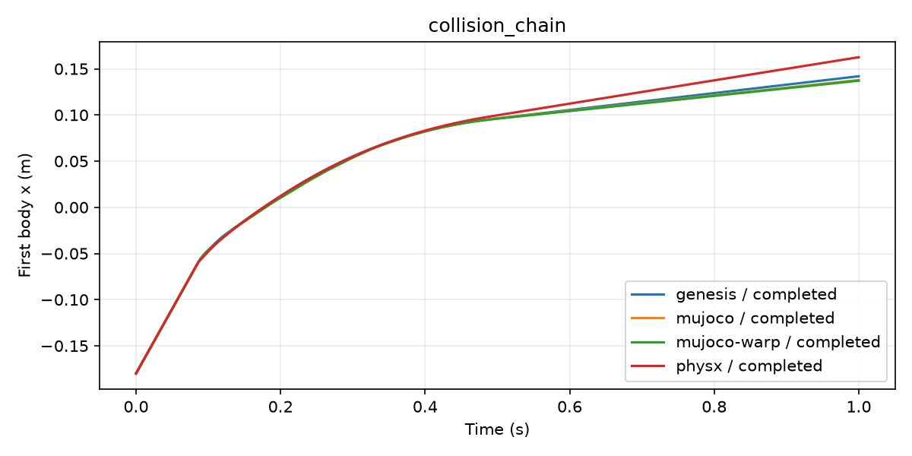

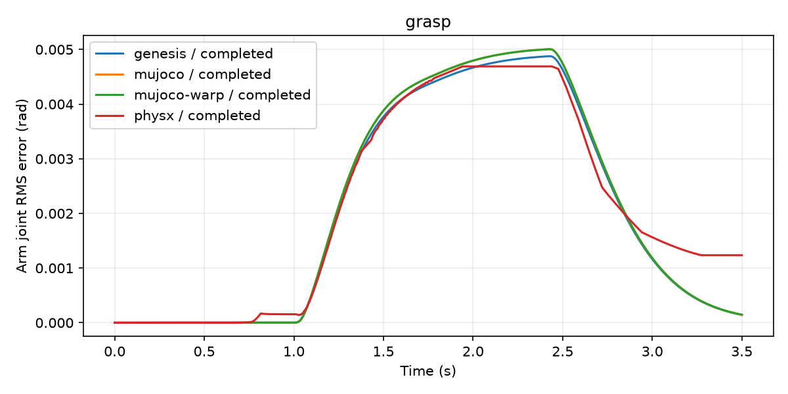

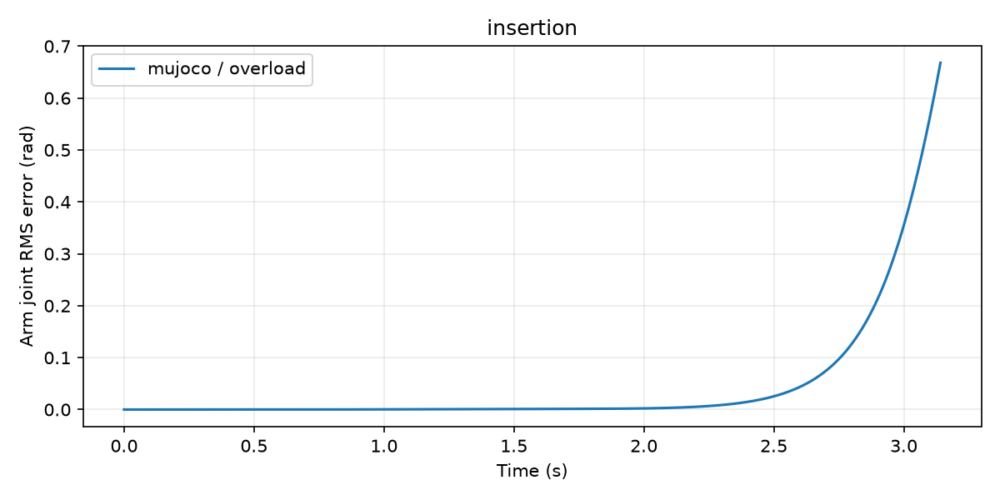

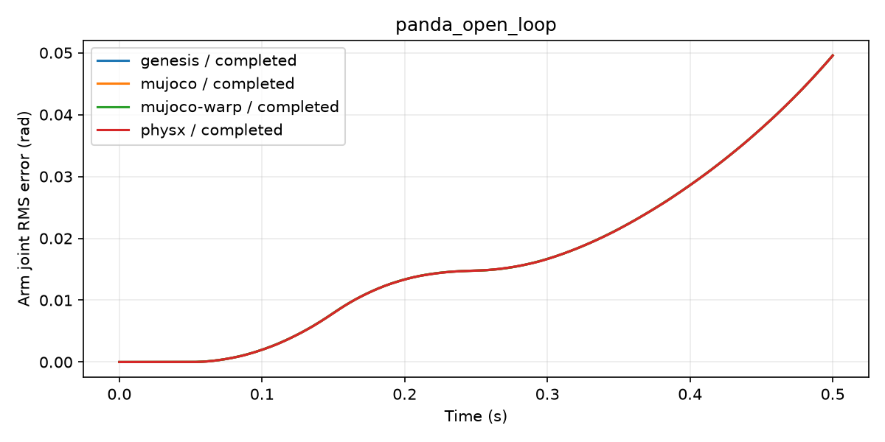

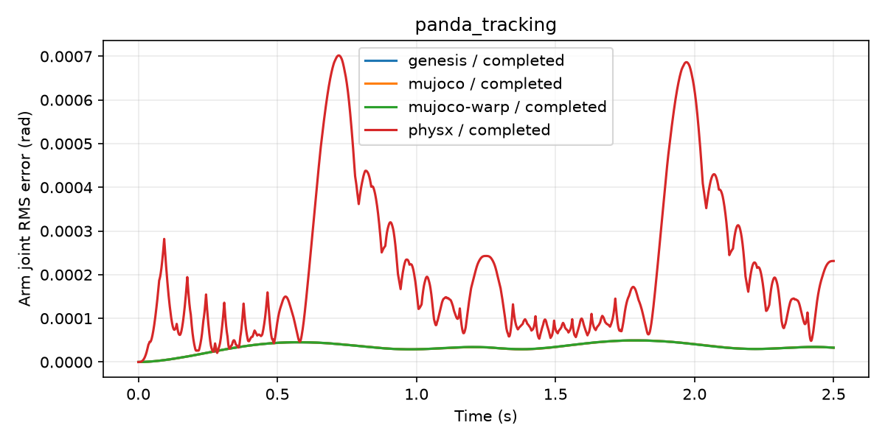

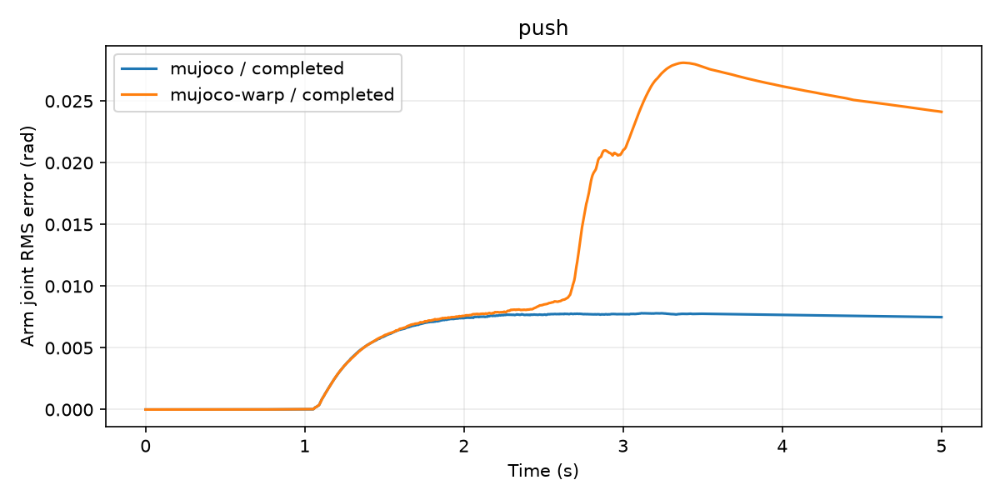

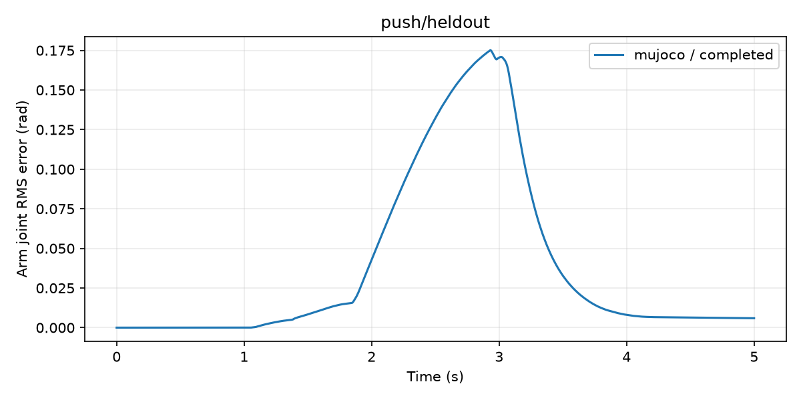

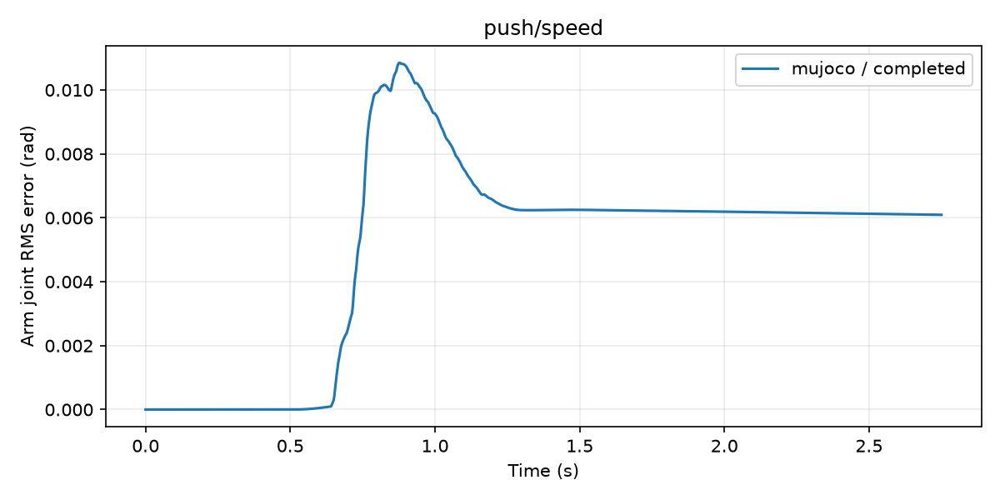

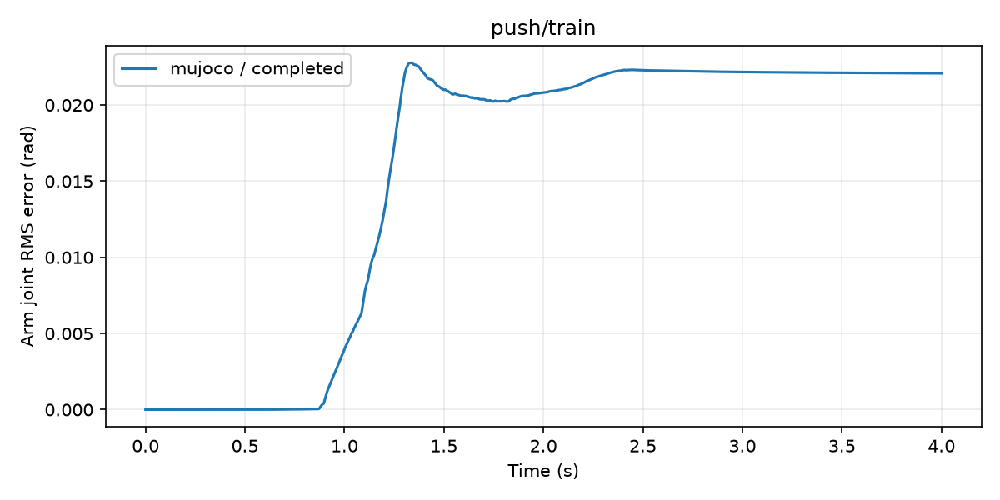

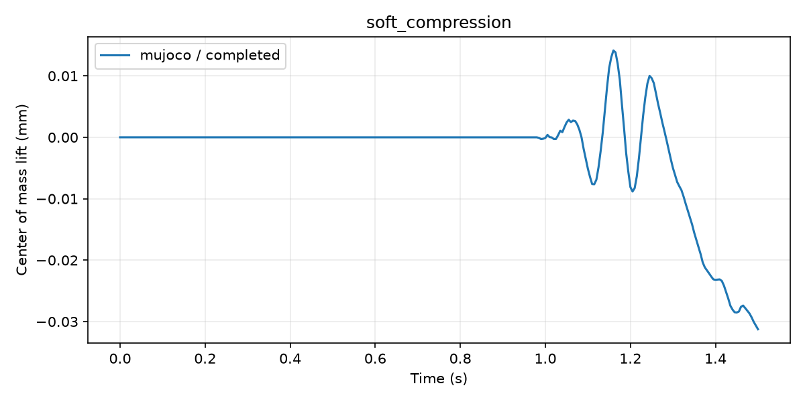

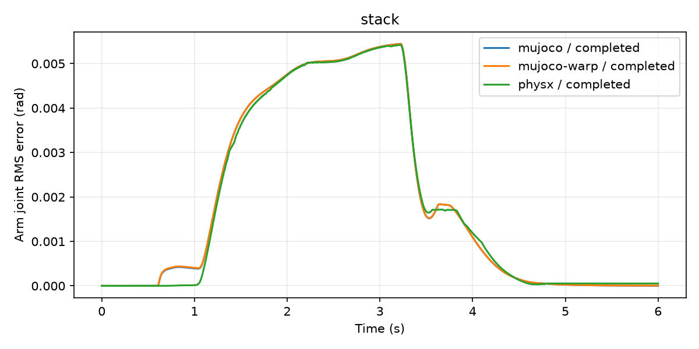

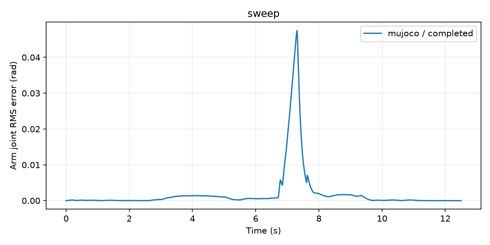
