# 扩展物理实验实测报告

数据来源：下列批次各次原生仿真的 `result.json` 和 `trajectory.npz`。任务失败、数值无效和接触力核算不通过分别记录；未运行配置列为缺失。恢复重试只统计最后一次，旧尝试仍保留。

- [.](./)

本批次 625 条记录沿用 594 次历史观测；不是新增独立重复。每条 result.json 的 provenance 保留原始结果 SHA256、配置、源码摘要与环境路径。计数按矩阵用途展示，汇总统计时不得把同一次观测的多个用途当作独立样本。完整映射见 [reuse-index.json](reuse-index.json)。

## 计划覆盖

| 批次 | 已记录 / 计划 | 缺失 |
|---|---:|---:|
| rigid/genesis | 111 / 111 | 0 |
| rigid/mujoco | 111 / 111 | 0 |
| rigid/mujoco-warp | 111 / 111 | 0 |
| rigid/physx | 111 / 111 | 0 |
| soft/mujoco | 12 / 12 | 0 |
| soft/mujoco-warp | 11 / 12 | 1 |
| soft/physx | 12 / 12 | 0 |
| tuning/genesis/heldout | 6 / 6 | 0 |
| tuning/genesis | 96 / 96 | 0 |
| tuning/mujoco/heldout | 12 / 12 | 0 |
| tuning/mujoco | 96 / 96 | 0 |
| tuning/mujoco-warp/heldout | 6 / 6 | 0 |
| tuning/mujoco-warp | 96 / 96 | 0 |
| tuning/physx/heldout | 12 / 12 | 0 |
| tuning/physx | 96 / 96 | 0 |

运行器尚未完成的批次：./transfer/mujoco: paused；./transfer/physx: paused；./soft/mujoco-warp: interrupted；./transfer/mujoco-warp: paused；./soft/genesis: paused；./transfer/genesis: paused；./soft/newton-vbd: paused；./throughput/mujoco: paused；./throughput/mujoco-warp: paused；./throughput/genesis: paused。

已生成计划中的缺失结果：1；历史尝试：0。尚未生成计划的后续批次不在该缺失数内，请同时检查运行器状态。

## 数值与任务结果

| 实验 | 引擎 | 已记录 | 数值有效 | 任务成功 | 力核算通过 | 异常/翻转 |
|---|---|---:|---:|---:|---:|---:|
| collision_chain | genesis | 6 | 6 | 6 | 6 | 0 |
| collision_chain | mujoco | 6 | 6 | 6 | 6 | 0 |
| collision_chain | mujoco-warp | 6 | 6 | 6 | 3 | 0 |
| collision_chain | physx | 6 | 6 | 6 | 6 | 0 |
| grasp | genesis | 6 | 6 | 6 | 0 | 0 |
| grasp | mujoco | 6 | 6 | 6 | 6 | 0 |
| grasp | mujoco-warp | 6 | 6 | 6 | 0 | 0 |
| grasp | physx | 6 | 6 | 6 | 6 | 0 |
| insertion | genesis | 30 | 30 | 24 | 0 | 0 |
| insertion | mujoco | 30 | 30 | 24 | 0 | 0 |
| insertion | mujoco-warp | 30 | 30 | 24 | 0 | 0 |
| insertion | physx | 30 | 30 | 21 | 0 | 0 |
| panda_open_loop | genesis | 6 | 6 | 6 | 0 | 0 |
| panda_open_loop | mujoco | 6 | 6 | 6 | 0 | 0 |
| panda_open_loop | mujoco-warp | 6 | 6 | 6 | 0 | 0 |
| panda_open_loop | physx | 6 | 6 | 6 | 0 | 0 |
| panda_tracking | genesis | 6 | 6 | 6 | 0 | 0 |
| panda_tracking | mujoco | 6 | 6 | 6 | 0 | 0 |
| panda_tracking | mujoco-warp | 6 | 6 | 6 | 0 | 0 |
| panda_tracking | physx | 6 | 6 | 6 | 0 | 0 |
| push | genesis | 36 | 36 | 9 | 0 | 0 |
| push | mujoco | 36 | 36 | 18 | 36 | 0 |
| push | mujoco-warp | 36 | 36 | 18 | 0 | 0 |
| push | physx | 36 | 36 | 18 | 36 | 0 |
| push/heldout | genesis | 6 | 6 | 3 | 0 | 0 |
| push/heldout | mujoco | 12 | 12 | 7 | 12 | 0 |
| push/heldout | mujoco-warp | 6 | 6 | 4 | 0 | 0 |
| push/heldout | physx | 12 | 12 | 6 | 12 | 0 |
| push/speed | genesis | 15 | 15 | 13 | 0 | 0 |
| push/speed | mujoco | 15 | 15 | 15 | 15 | 0 |
| push/speed | mujoco-warp | 15 | 15 | 15 | 0 | 0 |
| push/speed | physx | 15 | 15 | 14 | 15 | 0 |
| push/train | genesis | 81 | 81 | 61 | 0 | 0 |
| push/train | mujoco | 81 | 81 | 67 | 81 | 0 |
| push/train | mujoco-warp | 81 | 81 | 74 | 0 | 0 |
| push/train | physx | 81 | 81 | 76 | 81 | 0 |
| soft_compression | mujoco | 4 | 4 | 4 | 4 | 0 |
| soft_compression | mujoco-warp | 4 | 4 | 4 | 4 | 0 |
| soft_compression | physx | 4 | 4 | 4 | 0 | 0 |
| soft_grasp | mujoco | 8 | 2 | 2 | 8 | 6 |
| soft_grasp | mujoco-warp | 7 | 4 | 4 | 7 | 3 |
| soft_grasp | physx | 8 | 0 | 0 | 0 | 8 |
| stack | genesis | 18 | 18 | 12 | 18 | 0 |
| stack | mujoco | 18 | 18 | 12 | 18 | 0 |
| stack | mujoco-warp | 18 | 18 | 12 | 0 | 0 |
| stack | physx | 18 | 18 | 12 | 18 | 0 |
| sweep | genesis | 3 | 3 | 0 | 0 | 0 |
| sweep | mujoco | 3 | 3 | 0 | 3 | 0 |
| sweep | mujoco-warp | 3 | 3 | 0 | 0 | 0 |
| sweep | physx | 3 | 3 | 0 | 0 | 0 |

数值有效表示已完成相应状态校验；插销触发过载属于任务停止。力数据只有通过独立动量核算才可用于定量比较。所有软体质量从实际四面体体积计算；网格细化保留粗网格边界。

原文公开了协议和部分参数，没有公开完整场景源码及冻结轨迹。本项目依据公开协议独立实现，几何补全、引擎版本和硬件差异见 `docs/full-experiments.md`，这些数据不等同于原文复现值。

## 冻结控制器与迁移

训练选中：genesis: `None`；mujoco: `p0.5-d0.7-t2`；mujoco-warp: `None`；physx: `p0.5-d0.7-t4`。预留数据不参与选择。

| 控制器 | 测试引擎 | 成功 / 已记录 | 数值无效 | 平均归一化力矩平方 |
|---|---|---:|---:|---:|
| 本引擎预留/baseline | genesis | 3 / 6 | 0 | 0.0426951 |
| 本引擎预留/baseline | mujoco | 3 / 6 | 0 | 0.0409245 |
| 本引擎预留/baseline | mujoco-warp | 4 / 6 | 0 | 0.0381809 |
| 本引擎预留/baseline | physx | 4 / 6 | 0 | 0.0392554 |
| 本引擎预留/selected | mujoco | 4 / 6 | 0 | 0.0257679 |
| 本引擎预留/selected | physx | 2 / 6 | 0 | 0.0236056 |

## 软体步长、网格与力阈值

| 引擎 | 实验 | dt (µs) | 节点 | 指令力 (N) | SAP | 状态 | 保持段质心抬升 (mm) | 压缩反力 (N) |
|---|---|---:|---:|---:|---:|---|---:|---:|
| mujoco | soft_compression-00 | 50 | 125 | — | — | completed | — | 2.424 |
| mujoco | soft_compression-01 | 50 | 125 | — | — | completed | — | 2.424 |
| mujoco | soft_compression-02 | 50 | 125 | — | — | completed | — | 2.424 |
| mujoco | soft_compression-03 | 25 | 125 | — | — | completed | — | 2.424 |
| mujoco | soft_grasp-04 | 50 | 125 | 1 | — | inverted | — | — |
| mujoco | soft_grasp-05 | 50 | 125 | 1.1 | — | inverted | — | — |
| mujoco | soft_grasp-06 | 50 | 125 | 1.5 | — | inverted | — | — |
| mujoco | soft_grasp-07 | 50 | 125 | 2 | — | inverted | — | — |
| mujoco | soft_grasp-08 | 25 | 125 | 2 | — | inverted | — | — |
| mujoco | soft_grasp-09 | 12.5 | 125 | 2 | — | inverted | — | — |
| mujoco | soft_grasp-10 | 25 | 729 | 2 | — | completed | 64.51 | — |
| mujoco | soft_grasp-11 | 12.5 | 729 | 2 | — | completed | 64.39 | — |
| mujoco-warp | soft_compression-00 | 50 | 125 | — | — | completed | — | 2.277 |
| mujoco-warp | soft_compression-01 | 50 | 125 | — | — | completed | — | 2.277 |
| mujoco-warp | soft_compression-02 | 50 | 125 | — | — | completed | — | 2.277 |
| mujoco-warp | soft_compression-03 | 25 | 125 | — | — | completed | — | 2.277 |
| mujoco-warp | soft_grasp-04 | 50 | 125 | 1 | — | inverted | -3.108 | — |
| mujoco-warp | soft_grasp-05 | 50 | 125 | 1.1 | — | inverted | — | — |
| mujoco-warp | soft_grasp-06 | 50 | 125 | 1.5 | — | completed | 61.31 | — |
| mujoco-warp | soft_grasp-07 | 50 | 125 | 2 | — | completed | 63.64 | — |
| mujoco-warp | soft_grasp-08 | 25 | 125 | 2 | — | completed | 63.93 | — |
| mujoco-warp | soft_grasp-09 | 12.5 | 125 | 2 | — | completed | 63.71 | — |
| mujoco-warp | soft_grasp-10 | 25 | 729 | 2 | — | interrupted | — | — |
| physx | soft_compression-00 | 1000 | 125 | — | — | completed | — | — |
| physx | soft_compression-01 | 1000 | 125 | — | — | completed | — | — |
| physx | soft_compression-02 | 1000 | 125 | — | — | completed | — | — |
| physx | soft_compression-03 | 500 | 125 | — | — | completed | — | — |
| physx | soft_grasp-04 | 1000 | 125 | 1 | — | inverted | — | — |
| physx | soft_grasp-05 | 1000 | 125 | 1.1 | — | inverted | — | — |
| physx | soft_grasp-06 | 1000 | 125 | 1.5 | — | inverted | — | — |
| physx | soft_grasp-07 | 1000 | 125 | 2 | — | inverted | — | — |
| physx | soft_grasp-08 | 500 | 125 | 2 | — | inverted | — | — |
| physx | soft_grasp-09 | 250 | 125 | 2 | — | inverted | — | — |
| physx | soft_grasp-10 | 500 | 729 | 2 | — | inverted | — | — |
| physx | soft_grasp-11 | 250 | 729 | 2 | — | inverted | — | — |

## 固定控制器速度扫描

手部高度偏差从原生位姿计算，相对初始高度；范围跨三种布局，不是置信区间。

| 引擎 | 推送时长 (s) | 放置成功 / 已记录 | 数值无效 | 峰值高度偏差范围 (mm) |
|---|---:|---:|---:|---:|
| genesis | 0.75 | 3 / 3 | 0 | 0.4781–3.274 |
| genesis | 1 | 3 / 3 | 0 | 0.9347–30.09 |
| genesis | 1.5 | 3 / 3 | 0 | 0.5857–2.505 |
| genesis | 2 | 2 / 3 | 0 | 0.3823–2.684 |
| genesis | 3 | 2 / 3 | 0 | 0.1926–3.792 |
| mujoco | 0.75 | 3 / 3 | 0 | 1.658–3.902 |
| mujoco | 1 | 3 / 3 | 0 | 2.557–4.814 |
| mujoco | 1.5 | 3 / 3 | 0 | 3.466–5.133 |
| mujoco | 2 | 3 / 3 | 0 | 2.836–5.277 |
| mujoco | 3 | 3 / 3 | 0 | 4.774–6.768 |
| mujoco-warp | 0.75 | 3 / 3 | 0 | 1.938–4.139 |
| mujoco-warp | 1 | 3 / 3 | 0 | 2.674–4.88 |
| mujoco-warp | 1.5 | 3 / 3 | 0 | 2.793–6.011 |
| mujoco-warp | 2 | 3 / 3 | 0 | 1.747–6.536 |
| mujoco-warp | 3 | 3 / 3 | 0 | 4.257–6.813 |
| physx | 0.75 | 3 / 3 | 0 | 0.1651–3.886 |
| physx | 1 | 2 / 3 | 0 | 0.3203–5.233 |
| physx | 1.5 | 3 / 3 | 0 | 0.4834–1.953 |
| physx | 2 | 3 / 3 | 0 | 0.5202–1.354 |
| physx | 3 | 3 / 3 | 0 | 0.6924–1.744 |

## 参考轨迹一致性

在两个及以上引擎运行的 134 个配置中，参考摘要不一致：0。这只检查共同参考输入，不证明输出轨迹一致。

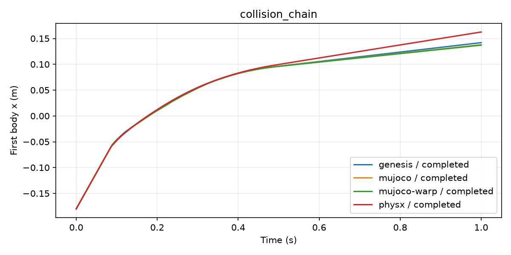

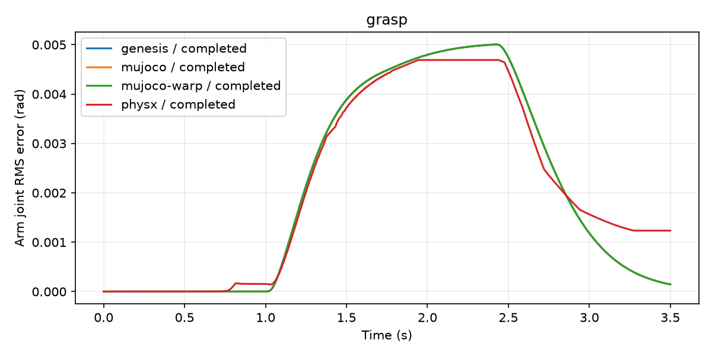

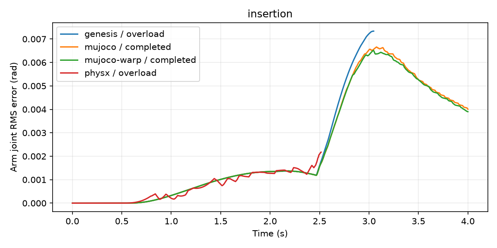

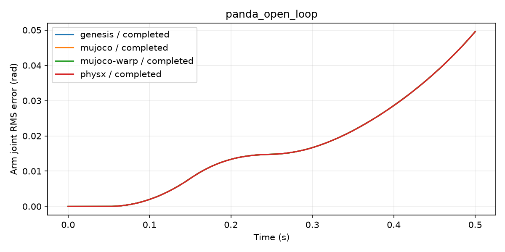

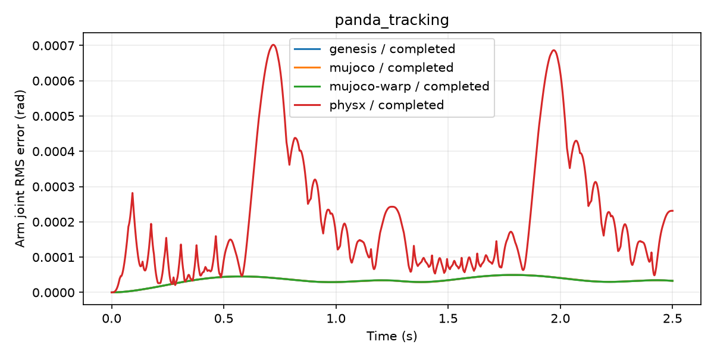

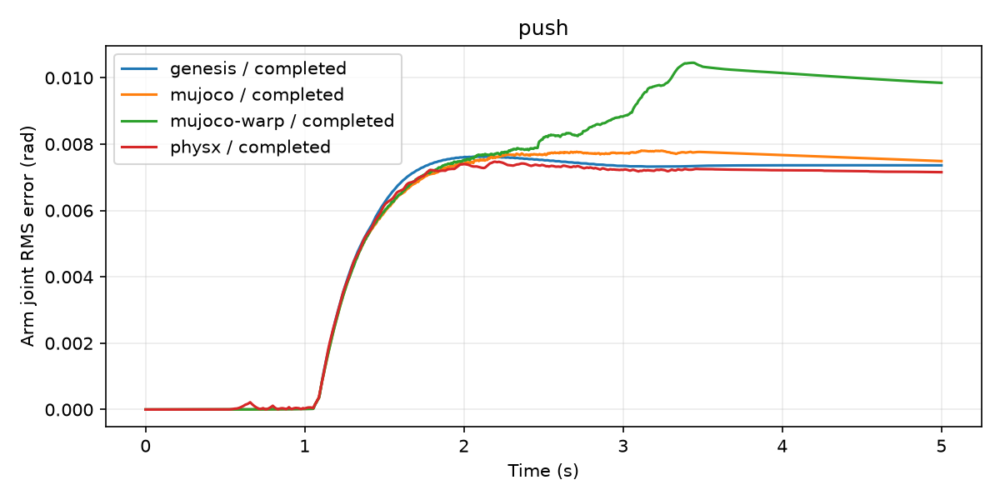

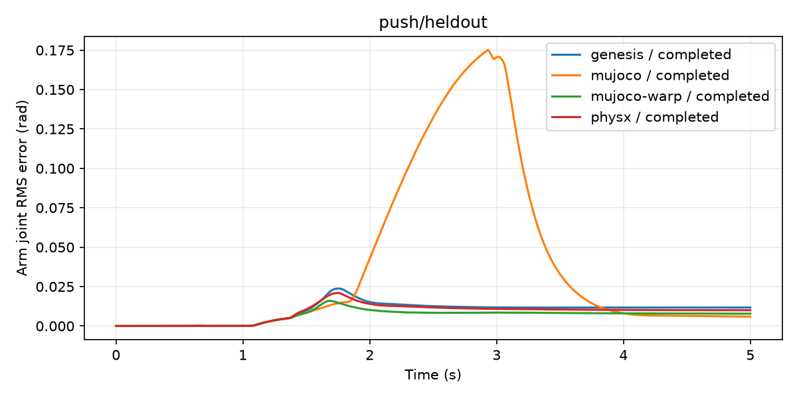

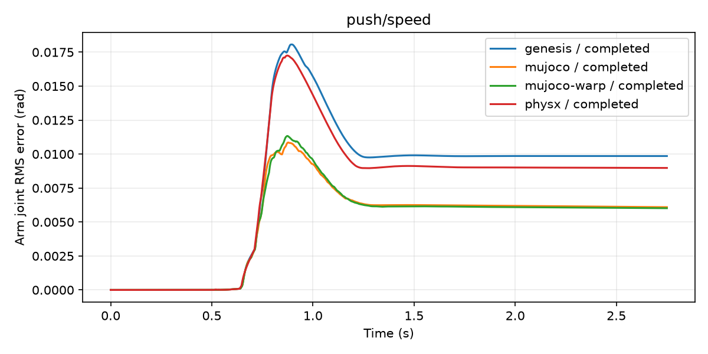

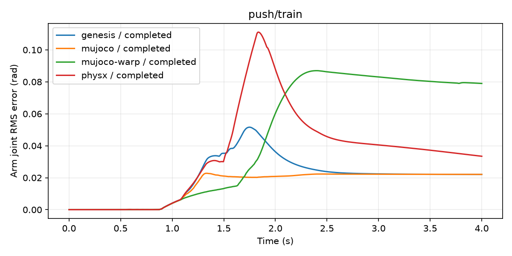

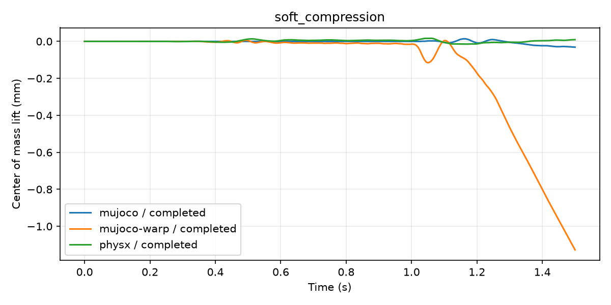

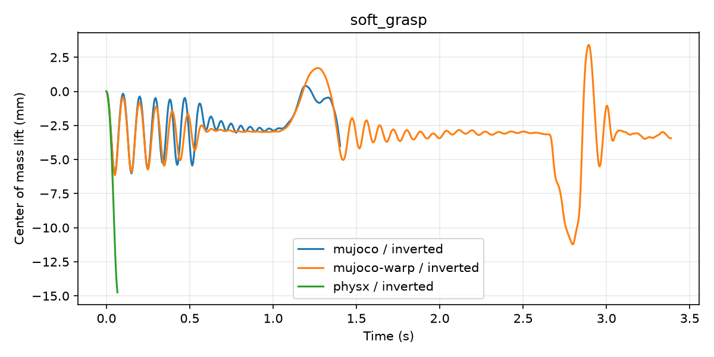

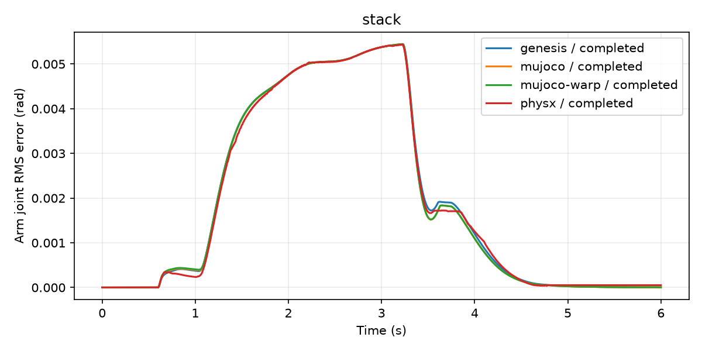

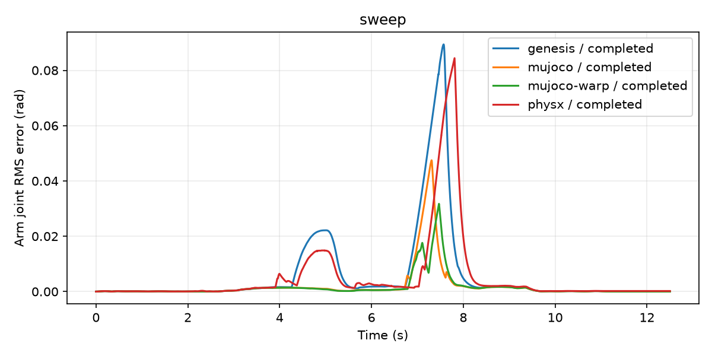
