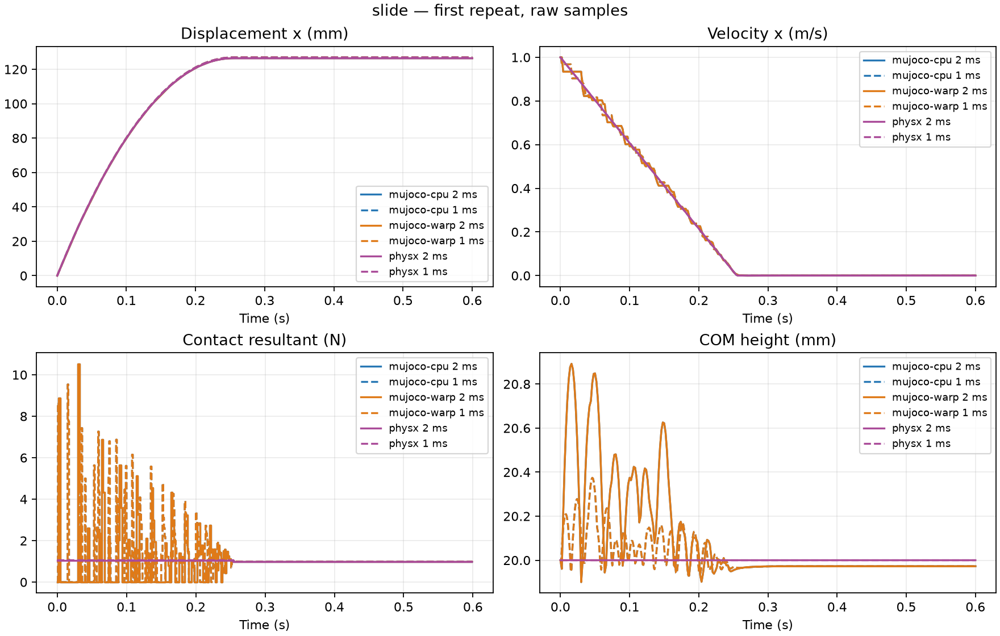
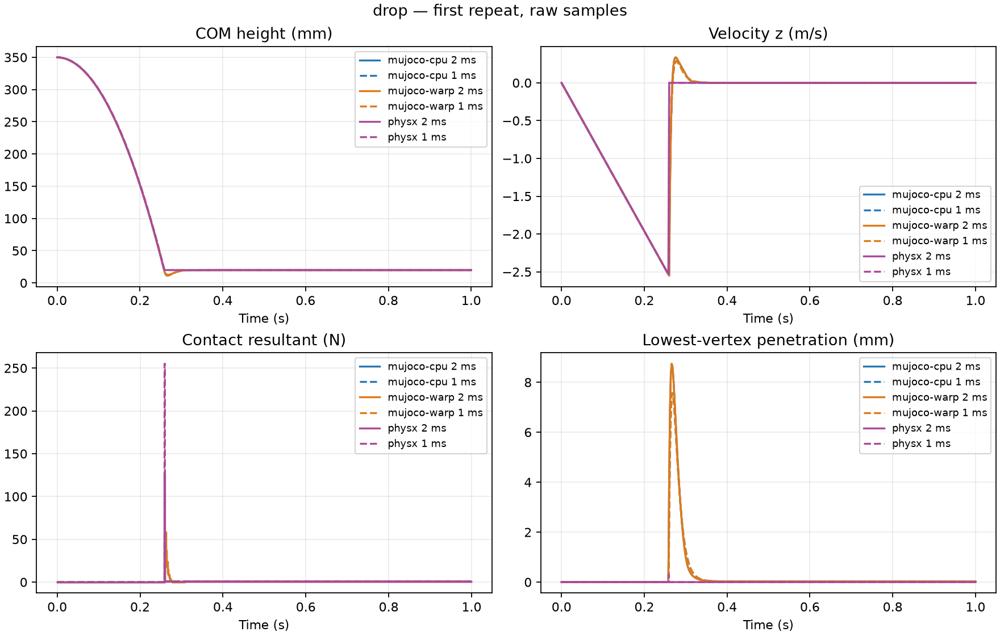
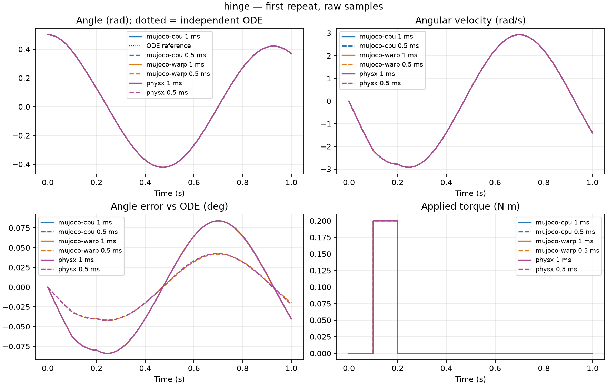

# 3 引擎基础场景对比

相同 SI 配置；保留全部重复与失败。表中为第一次重复，完整指标见 summary.csv。
当前实验测量物理响应，不测吞吐量；峰值力依赖步长及接触模型，不能单独作为准确性排名。

| 引擎 | 精度 | 通过 / 记录 | 来源 |
|---|---|---:|---|
| mujoco-cpu | float64 | 18/18 | [报告](../task02-cpu/report.md) |
| mujoco-warp | float32 | 18/18 | [报告](../task02-warp-validated/report.md) |
| physx | float32 | 18/18 | [报告](../task02-physx/report.md) |

实现差异与精确版本见 sources.json 及各组 imported.json。
MuJoCo-Warp 为直接 CUDA 后端；Genesis 为 CUDA float64；PhysX 为 Isaac Sim CPU TGS，
使用原生接触冲量除以步长。PhysX 的硬接触没有与 solref/solimp 一一对应的参数。
铰链参考为独立非线性 ODE 的 RK4 数值解。

## slide

| 引擎 | dt (ms) | 状态 | 停止距离 (m) | 停止时间 (s) | 40 ms Jx (N s) | 动量残差 (N s) |
|---|---:|---|---:|---:|---:|---:|
| mujoco-cpu | 2 | passed | 0.1264592 | 0.26 | -0.01773738 | 5.695671e-14 |
| mujoco-cpu | 1 | passed | 0.1269604 | 0.262 | -0.01833702 | 1.461703e-09 |
| mujoco-warp | 2 | passed | 0.1264592 | 0.26 | -0.01773741 | 1.168504e-07 |
| mujoco-warp | 1 | passed | 0.1269604 | 0.262 | -0.01833699 | 1.488448e-07 |
| physx | 2 | passed | 0.1264245 | 0.256 | -0.01569599 | 5.107052e-08 |
| physx | 1 | passed | 0.126918 | 0.255 | -0.01569599 | 5.828865e-08 |

## drop

| 引擎 | dt (ms) | 状态 | 峰值合力 (N) | 穿透 (m) | 40 ms Jz (N s) | 动量残差 (N s) |
|---|---:|---|---:|---:|---:|---:|
| mujoco-cpu | 2 | passed | 58.25719 | 0.00874061 | 0.3055474 | 5.86498e-14 |
| mujoco-cpu | 1 | passed | 53.44138 | 0.007567368 | 0.3034105 | 2.992932e-14 |
| mujoco-warp | 2 | passed | 58.25753 | 0.008740864 | 0.3055481 | 1.050828e-07 |
| mujoco-warp | 1 | passed | 53.44093 | 0.007567287 | 0.3034098 | 2.157924e-07 |
| physx | 2 | passed | 127.5279 | 1.208233e-08 | 0.2923375 | 1.401646e-08 |
| physx | 1 | passed | 255.0582 | 0.0003022277 | 0.2933184 | 4.960615e-08 |

## hinge

| 引擎 | dt (ms) | 状态 | 最大角误差 (rad) | RMS 角误差 (rad) | 力矩冲量 (N m s) |
|---|---:|---|---:|---:|---:|
| mujoco-cpu | 1 | passed | 0.001464387 | 0.001019878 | 0.02 |
| mujoco-cpu | 0.5 | passed | 0.0007312449 | 0.0005096072 | 0.02 |
| mujoco-warp | 1 | passed | 0.001464314 | 0.001019839 | 0.02 |
| mujoco-warp | 0.5 | passed | 0.0007312468 | 0.0005095909 | 0.02 |
| physx | 1 | passed | 0.001466304 | 0.001020922 | 0.02 |
| physx | 0.5 | passed | 0.0007412414 | 0.0005144419 | 0.02 |

