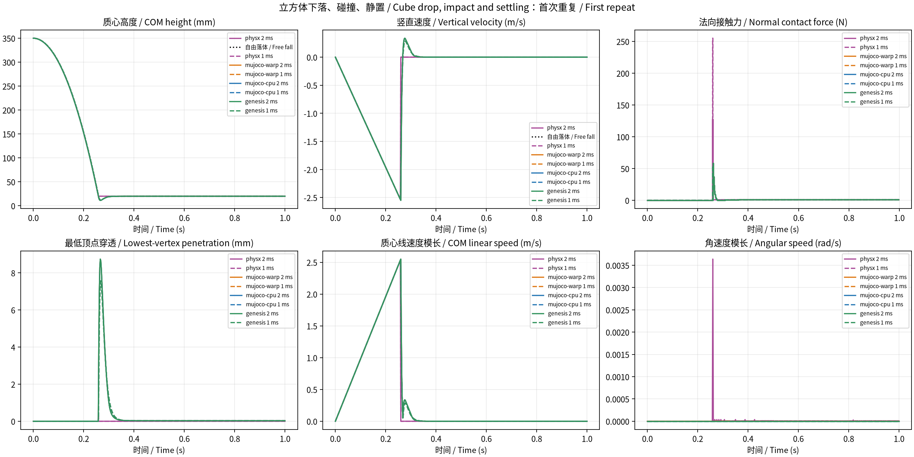

# 4 引擎基础场景对比 / Multi-engine baseline comparison

相同 SI 配置；保留全部重复与失败。表中为第一次重复，完整指标见 summary.csv。
当前实验测量物理响应，不测吞吐量；峰值力依赖步长及接触模型，不能单独作为准确性排名。

| 引擎 / Engine | 精度 / Precision | 通过 / 记录 (Passed / Recorded) | 来源 / Source |
|---|---|---:|---|
| physx | float32 | 6/6 | [报告 / Report](../physx/report.md) |
| mujoco-warp | float32 | 6/6 | [报告 / Report](../mujoco-warp/report.md) |
| mujoco-cpu | float64 | 6/6 | [报告 / Report](../mujoco-cpu/report.md) |
| genesis | float64 | 6/6 | [报告 / Report](../genesis/report.md) |

实现差异与精确版本见 sources.json 及各组 imported.json。
MuJoCo-Warp 为直接 CUDA 后端；Genesis 为 CUDA float64；PhysX 为 Isaac Sim CPU TGS，
使用原生接触冲量除以步长。PhysX 的硬接触没有与 solref/solimp 一一对应的参数。
铰链参考为独立非线性 ODE 的 RK4 数值解。

## 方块下落 / Cube drop

| 引擎 / Engine | 步长 / Timestep (ms) | 状态 / Status | 峰值接触合力 / Peak resultant contact force (N) | 最大穿透深度 / Maximum penetration depth (m) | 窗口接触冲量Z / Window contact impulse Z (N·s) | 最大动量平衡残差 / Maximum momentum balance residual (N·s) |
|---|---:|---|---:|---:|---:|---:|
| physx | 2 | 通过 / Passed | 127.5279 | 1.208233e-08 | 0.2923375 | 1.401646e-08 |
| physx | 1 | 通过 / Passed | 255.0582 | 0.0003022277 | 0.2933184 | 4.960615e-08 |
| mujoco-warp | 2 | 通过 / Passed | 58.25753 | 0.008740864 | 0.3055481 | 1.050828e-07 |
| mujoco-warp | 1 | 通过 / Passed | 53.44093 | 0.007567287 | 0.3034098 | 2.157924e-07 |
| mujoco-cpu | 2 | 通过 / Passed | 58.25719 | 0.00874061 | 0.3055474 | 5.86498e-14 |
| mujoco-cpu | 1 | 通过 / Passed | 53.44138 | 0.007567368 | 0.3034105 | 2.992932e-14 |
| genesis | 2 | 通过 / Passed | 58.25719 | 0.00874061 | 0.3055474 | 5.86458e-14 |
| genesis | 1 | 通过 / Passed | 53.44138 | 0.007567368 | 0.3034105 | 2.992593e-14 |

## 立方体下落、碰撞、静置 / Cube drop, impact and settling

首次重复 / First repeat；全部重复与统计见 [双语明细](metrics_bilingual.md)、[CSV](metrics_bilingual.csv)、[统计CSV](metric_stats_bilingual.csv)。

### 碰撞响应 / Impact response

| 引擎 / Engine | 步长 / Timestep (ms) | 状态 / Status | 首次接触时间 / First contact time (s) | 首次接触时间相对理想值偏差 / First contact time deviation from ideal (s) | 首次接触步初竖直速度 / Vertical velocity at start of first contact step (m/s) | 接触后最大向上速度 / Peak upward velocity after contact (m/s) | 峰值法向接触力 / Peak normal contact force (N) | 最大穿透深度 / Maximum penetration depth (m) | 最大动量平衡残差 / Maximum momentum balance residual (N·s) |
|---|---:|---|---:|---:|---:|---:|---:|---:|---:|
| PhysX（Isaac Sim CPU TGS） | 2 | 通过 / Passed | 0.258 | -0.0013805842 | -2.53097558 | 4.58310145e-09 | 127.527893 | 1.20823339e-08 | 1.40164555e-08 |
| PhysX（Isaac Sim CPU TGS） | 1 | 通过 / Passed | 0.259 | -0.000380584204 | -2.54078412 | 0 | 255.058203 | 0.000302227661 | 4.96061517e-08 |
| MuJoCo-Warp（直接 CUDA） | 2 | 通过 / Passed | 0.26 | 0.000619415796 | -2.55060148 | 0.337274969 | 58.2575302 | 0.00874086356 | 1.05082791e-07 |
| MuJoCo-Warp（直接 CUDA） | 1 | 通过 / Passed | 0.259 | -0.000380584204 | -2.54078698 | 0.284650892 | 53.4409294 | 0.00756728704 | 2.15792418e-07 |
| MuJoCo CPU | 2 | 通过 / Passed | 0.26 | 0.000619415796 | -2.5506 | 0.337265512 | 58.2571948 | 0.00874060957 | 5.86498037e-14 |
| MuJoCo CPU | 1 | 通过 / Passed | 0.259 | -0.000380584204 | -2.54079 | 0.284654009 | 53.441377 | 0.00756736771 | 2.99293229e-14 |
| Genesis CUDA | 2 | 通过 / Passed | 0.26 | 0.000619415796 | -2.5506 | 0.337265512 | 58.2571948 | 0.00874060957 | 5.86457966e-14 |
| Genesis CUDA | 1 | 通过 / Passed | 0.259 | -0.000380584204 | -2.54079 | 0.284654009 | 53.441377 | 0.00756736771 | 2.99259315e-14 |

### 静置状态 / Settling state

| 引擎 / Engine | 步长 / Timestep (ms) | 状态 / Status | 刚体静置时间 / Rigid-body settling time (s) | 静置后观察时长 / Observation duration after settling (s) | 记录时长内刚体已静置 / Rigid body settled within recorded duration (boolean) | 最终质心高度 / Final COM height (m) | 最终质心线速度模长 / Final COM linear speed (m/s) | 最终角速度模长 / Final angular speed (rad/s) | 末段平均支撑力与重力比 / Final-window mean support force to weight ratio (1) |
|---|---:|---|---:|---:|---:|---:|---:|---:|---:|
| PhysX（Isaac Sim CPU TGS） | 2 | 通过 / Passed | 0.26 | 0.74 | 是 / Yes | 0.0200000051 | 8.60713628e-07 | 5.97454577e-06 | 1.0000001 |
| PhysX（Isaac Sim CPU TGS） | 1 | 通过 / Passed | 0.26 | 0.74 | 是 / Yes | 0.0199999958 | 4.73114187e-07 | 8.10296388e-06 | 1.00000005 |
| MuJoCo-Warp（直接 CUDA） | 2 | 通过 / Passed | 0.36 | 0.64 | 是 / Yes | 0.0199726932 | 2.64306067e-07 | 7.27559249e-10 | 1.0000001 |
| MuJoCo-Warp（直接 CUDA） | 1 | 通过 / Passed | 0.364 | 0.636 | 是 / Yes | 0.0199726876 | 5.28989574e-07 | 1.94488421e-10 | 1.00000009 |
| MuJoCo CPU | 2 | 通过 / Passed | 0.36 | 0.64 | 是 / Yes | 0.0199726992 | 1.02069338e-14 | 0 | 1 |
| MuJoCo CPU | 1 | 通过 / Passed | 0.364 | 0.636 | 是 / Yes | 0.0199726992 | 6.1178594e-16 | 0 | 1 |
| Genesis CUDA | 2 | 通过 / Passed | 0.36 | 0.64 | 是 / Yes | 0.0199726992 | 1.02368306e-14 | 2.12800614e-17 | 1 |
| Genesis CUDA | 1 | 通过 / Passed | 0.364 | 0.636 | 是 / Yes | 0.0199726992 | 6.14312072e-16 | 1.4436385e-17 | 1 |

理想自由落体 / Ideal free fall：质心初始高度 h₀、初速度0，z=h₀−gt²/2、vz=−gt；平放立方体首次接触参考 t=√(2(h₀−边长/2)/g)。参考只对无接触段比较；积分离散误差与接触偏置会影响首次接触时间。
首次接触用原生接触合力>1e-9 N的首个步初时间，碰撞前速度取该步初vz；最大向上速度取首次接触后所有已记录状态，不推算材料恢复系数。
刚体静置 / Rigid-body settling：质心线速度<0.001 m/s，角速度×立方体半对角线也低于该阈值，且前一步法向支撑力>1e-9 N，要求此后所有已记录状态持续满足。原质心静置时间仅检查线速度，继续保留。
末段支撑力为最后40 ms法向力的时间平均，该窗口须全部位于首次接触后；支撑力/重力比约为1表示平均支撑重力。
通过 / Passed表示参数、有限性和动量校验通过；是否已静置另列布尔指标。静置结论只覆盖记录时长，静置后观察时长另行保存；未测得不填零。

## 本轮验收 / Batch acceptance

正式24/24无界面与8/8界面通过；显示退出码均为0，GUI/无界面本轮逐步数值完全一致。
仅 `viewer-final-*` 纳入界面验收，先前慢速、中断和GLX清理诊断均保留。
执行命令、源码阶段、77项测试、18组CPU回归和历史文件核对见 [本轮执行与验收](../report.md)、[审计](../audit.json)。
