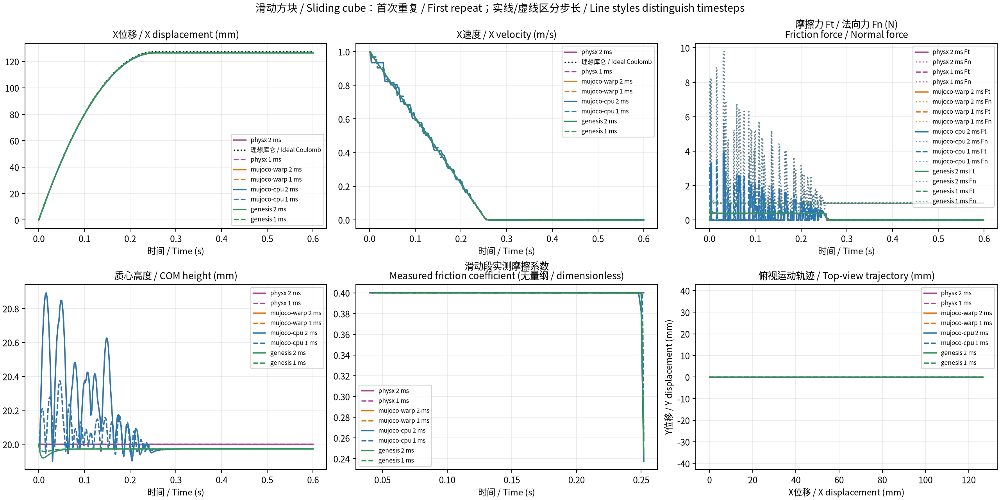

# 4 引擎基础场景对比 / Multi-engine baseline comparison

相同 SI 配置；保留全部重复与失败。表中为第一次重复，完整指标见 summary.csv。
当前实验测量物理响应，不测吞吐量；峰值力依赖步长及接触模型，不能单独作为准确性排名。

| 引擎 / Engine | 精度 / Precision | 通过 / 记录 (Passed / Recorded) | 来源 / Source |
|---|---|---:|---|
| physx | float32 | 6/6 | [报告 / Report](../physx-retry-02/report.md) |
| mujoco-warp | float32 | 6/6 | [报告 / Report](../mujoco-warp/report.md) |
| mujoco-cpu | float64 | 6/6 | [报告 / Report](../mujoco-cpu/report.md) |
| genesis | float64 | 6/6 | [报告 / Report](../genesis/report.md) |

实现差异与精确版本见 sources.json 及各组 imported.json。
MuJoCo-Warp 为直接 CUDA 后端；Genesis 为 CUDA float64；PhysX 为 Isaac Sim CPU TGS，
使用原生接触冲量除以步长。PhysX 的硬接触没有与 solref/solimp 一一对应的参数。
铰链参考为独立非线性 ODE 的 RK4 数值解。

## 滑动方块 / Sliding cube

| 引擎 / Engine | 步长 / Timestep (ms) | 状态 / Status | 停止距离 / Stopping distance (m) | 停止时间 / Stopping time (s) | 窗口接触冲量X / Window contact impulse X (N·s) | 最大动量平衡残差 / Maximum momentum balance residual (N·s) |
|---|---:|---|---:|---:|---:|---:|
| physx | 2 | 通过 / Passed | 0.1264245 | 0.256 | -0.01569599 | 5.107052e-08 |
| physx | 1 | 通过 / Passed | 0.126918 | 0.255 | -0.01569599 | 5.828865e-08 |
| mujoco-warp | 2 | 通过 / Passed | 0.1264594 | 0.26 | -0.01773739 | 7.011896e-08 |
| mujoco-warp | 1 | 通过 / Passed | 0.1269605 | 0.262 | -0.018337 | 1.522009e-07 |
| mujoco-cpu | 2 | 通过 / Passed | 0.1264592 | 0.26 | -0.01773738 | 5.695671e-14 |
| mujoco-cpu | 1 | 通过 / Passed | 0.1269604 | 0.262 | -0.01833702 | 1.461703e-09 |
| genesis | 2 | 通过 / Passed | 0.1264527 | 0.26 | -0.01650766 | 5.72049e-14 |
| genesis | 1 | 通过 / Passed | 0.1269607 | 0.262 | -0.0160995 | 2.872138e-14 |

## 滑动方块：摩擦与运动轨迹 / Sliding cube: friction and trajectory

表中为第一次重复 / First repeat；全部重复、中英文名称、单位与统计见 [中英文指标明细 / Bilingual details](metrics_bilingual.md)、[CSV](metrics_bilingual.csv)、[统计 / Statistics CSV](metric_stats_bilingual.csv)。

| 引擎 / Engine | 步长 / Timestep (ms) | 状态 / Status | 实测等效摩擦系数 / Measured effective friction coefficient (1) | 滑动段平均摩擦力 / Mean sliding friction force (N) | 滑动段平均X减速度 / Mean sliding X deceleration (m/s²) | 停止时间 / Stopping time (s) | 停止距离 / Stopping distance (m) | 停止距离相对理想值偏差 / Stopping distance deviation from ideal (%) | 相对理想轨迹最大X位移误差 / Maximum X displacement error vs ideal trajectory (m) | 最大动量平衡残差 / Maximum momentum balance residual (N·s) |
|---|---:|---|---:|---:|---:|---:|---:|---:|---:|---:|
| PhysX（Isaac Sim CPU TGS） | 2 | 通过 / Passed | 0.399999867 | 0.392399915 | 3.92400359 | 0.256 | 0.126424491 | -0.782059145 | 0.000996507575 | 5.1070518e-08 |
| PhysX（Isaac Sim CPU TGS） | 1 | 通过 / Passed | 0.399999867 | 0.39239991 | 3.92404867 | 0.255 | 0.126917973 | -0.394774663 | 0.000503130128 | 5.82886485e-08 |
| MuJoCo-Warp（直接 CUDA） | 2 | 通过 / Passed | 0.398300076 | 0.385045514 | 3.8504554 | 0.26 | 0.12645939 | -0.754670787 | 0.000972675446 | 7.0118965e-08 |
| MuJoCo-Warp（直接 CUDA） | 1 | 通过 / Passed | 0.399278816 | 0.380860409 | 3.80859286 | 0.262 | 0.126960471 | -0.361422145 | 0.000482082642 | 1.52200873e-07 |
| MuJoCo CPU | 2 | 通过 / Passed | 0.398299833 | 0.385045505 | 3.85045505 | 0.26 | 0.126459227 | -0.754798693 | 0.000972839409 | 5.69567052e-14 |
| MuJoCo CPU | 1 | 通过 / Passed | 0.399278725 | 0.380859276 | 3.80859271 | 0.262 | 0.126960411 | -0.361469084 | 0.000482144149 | 1.46170299e-09 |
| Genesis CUDA | 2 | 通过 / Passed | 0.398523276 | 0.39082509 | 3.9082509 | 0.26 | 0.126452747 | -0.75988401 | 0.000979638872 | 5.72049027e-14 |
| Genesis CUDA | 1 | 通过 / Passed | 0.398982124 | 0.391349236 | 3.91349236 | 0.262 | 0.126960671 | -0.361265674 | 0.000482776014 | 2.87213848e-14 |

滑动段测量窗口：首次接触之后排除启动阶段 40 ms；步初水平速度 > 0.01 m/s。平均力与减速度包含离地步的零接触力。
实测等效摩擦系数 = Σ(水平接触力模长×dt) / Σ(法向力×dt)，系数仅使用窗口内法向力 > 1e-9 N 的接触步；无有效接触时为未测得。
理想参考为水平刚性平面上的纯平移库仑模型：a=μg，v=max(v₀−at,0)，x=v₀t−at²/2（停止后保持）；不含接触启动、转动或软接触，轨迹误差用于观察模型差异。
停止时间使用|vx|低于配置阈值且此后所有采样保持低于阈值的首个时刻；停止距离取该时刻X位移。所有指标仅覆盖已记录时长。

## 本轮运行记录 / Batch execution audit

本目录汇总新计算的正式24组；8组界面核对也已通过。旧结果保留。
首轮PhysX末组超时和随后初始化中断均已保存，最终六组重跑全部通过。
完整执行、诊断与界面核对见 [本轮记录](../report.md) 和 [审计JSON](../audit.json)。
