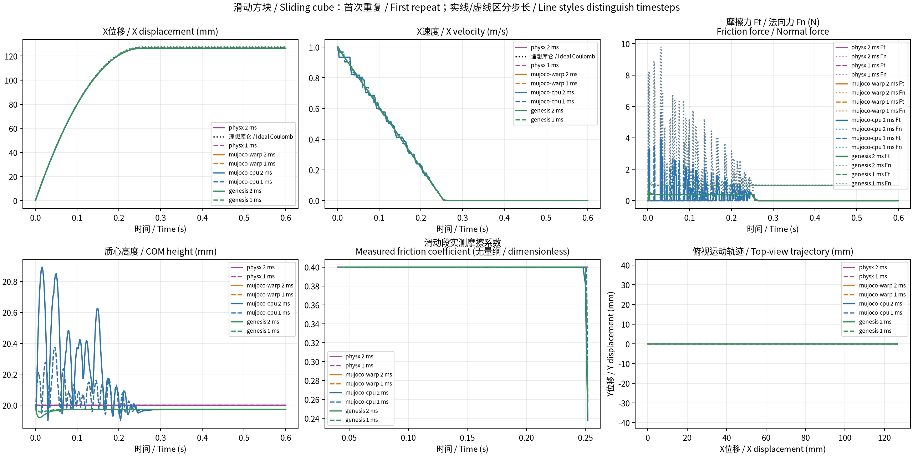

# 滑动方块重新实测 / Sliding cube rerun

完成时间：2026-10-10 18:41:08（Asia/Shanghai）。本轮从初始条件重新计算物理数据。

- 正式无界面：四引擎、2 ms / 1 ms 各三次独立重复，24/24 组通过，10800 物理步。
- 界面验证：四引擎、两步长各一次，8/8 组通过，3600 物理步；0.2 倍播放速度、结束保持 2 s。
- 沿用 `configs/baseline.json`：质量 0.1 kg、边长 0.04 m、初速度 1 m/s、摩擦系数 0.4、重力 9.81 m/s²、时长 0.6 s。
- 65 项测试、Ruff 和差异空白检查通过；未修改物理代码或参数。
- 中英文汇总包含 792 条指标明细和 264 条分组统计，数值保留原始精度。

以下为首次重复，全部重复见 CSV。理想库仑停止距离为 127.420999 mm。

| 引擎 / Engine | 步长 / Timestep (ms) | 实测摩擦系数 / Measured friction coefficient (1) | 平均摩擦力 / Mean friction force (N) | 停止时间 / Stopping time (s) | 停止距离 / Stopping distance (mm) | 最大动量残差 / Maximum momentum residual (N·s) |
|---|---:|---:|---:|---:|---:|---:|
| PhysX CPU TGS | 2 | 0.399999867 | 0.392399915 | 0.256 | 126.424491 | 5.10705e-08 |
| PhysX CPU TGS | 1 | 0.399999867 | 0.392399910 | 0.255 | 126.917973 | 5.82886e-08 |
| MuJoCo-Warp CUDA | 2 | 0.398300076 | 0.385045514 | 0.260 | 126.459390 | 7.0119e-08 |
| MuJoCo-Warp CUDA | 1 | 0.399278816 | 0.380860409 | 0.262 | 126.960471 | 1.52201e-07 |
| MuJoCo CPU | 2 | 0.398299833 | 0.385045505 | 0.260 | 126.459227 | 5.69567e-14 |
| MuJoCo CPU | 1 | 0.399278725 | 0.380859276 | 0.262 | 126.960411 | 1.4617e-09 |
| Genesis CUDA | 2 | 0.398523276 | 0.390825090 | 0.260 | 126.452747 | 5.72049e-14 |
| Genesis CUDA | 1 | 0.398982124 | 0.391349236 | 0.262 | 126.960671 | 2.87214e-14 |

所有正式运行的摩擦力均反向于滑动，动量残差小于 5×10⁻⁶ N·s。步长减半后，停止距离更接近理想参考。
参考忽略转动及接触启动，不用轨迹偏差给引擎做准确性排名。

界面逐步核对：CPU、Genesis、PhysX 各数值列一致；Warp 存在微小 float32 重复差异，
最大位置差 1.93715×10⁻⁷ m、最大接触力差 5.22733×10⁻⁵ N，均在提前设定的容差内。
显示最终姿态与真实采样一致，每组显示帧数为 60–87；停止时间差均为零。
与上一轮正式数据核对，CPU、Genesis、PhysX 数值一致，Warp 的差异也在相同容差内。
534 个历史结果文件 SHA-256 一致；源码及配置指纹一致。

实际环境沿用：MuJoCo 3.15.0；MuJoCo-Warp 3.15.0 / Warp 1.16.0；
Genesis 1.4.3 / Quadrants 1.3.3 / PyTorch 2.8.0；Isaac Sim 6.0.1 / PhysX CPU TGS。
使用 RTX 4090 D、驱动 570.211.01；PhysX 为 CPU 求解，CUDA 后端为 Warp 和 Genesis。
任务中的 Newton / MuJoCo-Warp 仍采用直接 MuJoCo-Warp CUDA 路径。
每个目录保存 environment.json，各组保存 imported.json。

本轮保留的诊断：首轮 PhysX 为 5/6 通过，最后一组采样前等待超时；
`physx-retry-01` 在 Isaac Sim 初始化期间被会话中断，未取得采样；
最终 `physx-retry-02` 六组全部通过。未用失败或中断运行补齐正式统计，根因尚未确认。
下落、铰链及已暂停的完整扩展实验未启动。

- [四引擎中英文汇总](comparison/report.md)
- [中英文指标明细](comparison/metrics_bilingual.md)
- [全部重复的指标 CSV](comparison/metrics_bilingual.csv)
- [重复统计 CSV](comparison/metric_stats_bilingual.csv)
- [逐步核对及历史校验](audit.json)
- [精确执行命令与来源指纹](rerun_manifest.json)
- [PhysX 首轮失败记录](physx/slide/dt_0.001/repeat_02/failure.json)
- [PhysX 初始化中断记录](physx-retry-01/interruption.json)



本轮实际执行的命令如下；这些输出目录已有结果，重复执行时请换新目录。

```bash
.venv/bin/physics-bench run --engine physx --scene slide --headless --repeats 3 --output results/task04-slide-rerun-20261010-1818/physx-retry-02
.venv-warp/bin/physics-bench run --engine mujoco-warp --scene slide --headless --repeats 3 --output results/task04-slide-rerun-20261010-1818/mujoco-warp
.venv/bin/physics-bench run --engine mujoco-cpu --scene slide --headless --repeats 3 --output results/task04-slide-rerun-20261010-1818/mujoco-cpu
.venv-genesis/bin/physics-bench run --engine genesis --scene slide --headless --repeats 3 --output results/task04-slide-rerun-20261010-1818/genesis
.venv/bin/physics-bench run --engine physx --scene slide --viewer --repeats 1 --output results/task04-slide-rerun-20261010-1818/viewer-physx
.venv-warp/bin/physics-bench run --engine mujoco-warp --scene slide --viewer --repeats 1 --output results/task04-slide-rerun-20261010-1818/viewer-mujoco-warp
.venv/bin/physics-bench run --engine mujoco-cpu --scene slide --viewer --repeats 1 --output results/task04-slide-rerun-20261010-1818/viewer-mujoco-cpu
.venv-genesis/bin/physics-bench run --engine genesis --scene slide --viewer --repeats 1 --output results/task04-slide-rerun-20261010-1818/viewer-genesis
.venv/bin/physics-bench compare results/task04-slide-rerun-20261010-1818/physx-retry-02 results/task04-slide-rerun-20261010-1818/mujoco-warp results/task04-slide-rerun-20261010-1818/mujoco-cpu results/task04-slide-rerun-20261010-1818/genesis --output results/task04-slide-rerun-20261010-1818/comparison
```
